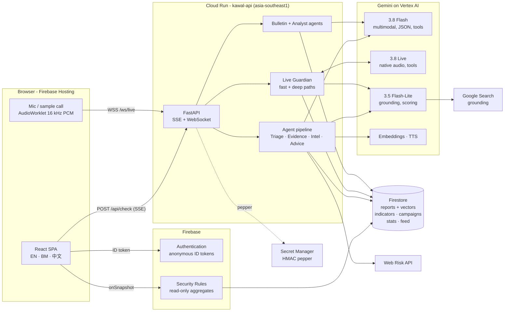
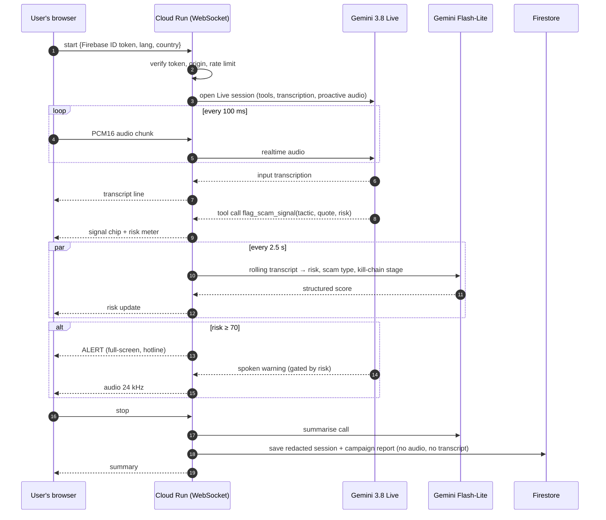

<div align="center">


# Kawal

**The AI that sits on the call with you - real-time, multilingual scam interception for Asia-Pacific.**

*Kawal* (Malay / Indonesian for “guard”) listens to suspicious calls as they happen, checks messages, links and
screenshots in English, Bahasa Melayu and 中文, and turns every check into redacted, real-time scam intelligence
for banks and regulators.

[](https://kawal-ai.web.app)
[](#-links)


Google Cloud **AI Builder Cup 2026** · Track: **BFSI - Intelligent Risk, Fraud & Financial Experiences** · Team **AwanPurple**

</div>

---

## TL;DR

- **Problem:** Southeast Asians lost an estimated **US$23.6 billion** to scams in a single year, and **63%** experienced one ([GASA 2025](https://gasa.org/knowledge-base/blog/new-study-reveals-63-of-southeast-asians-experienced-scams-in-past-year)). In Singapore, **81.8%** of scam losses in 2025 were *self-effected transfers* - victims moving money themselves while being manipulated live ([SPF](https://www.police.gov.sg/media-hub/police-life/2026/02/scams-and-cybercrime-fell-by-almost-a-quarter-in-2025)). Blocklists and SMS filters do not help at that moment.
- **Kawal intervenes during the persuasion, not after:** put the call on speaker and **Gemini 3.8 Live** flags tactics (fake police, “safe account”, secrecy, OTP requests) within ~1 s of hearing them and *speaks* a warning in the victim's language.
- **Multimodal Scam Check:** paste a message or drop a screenshot / voice note → a Gemini **agent pipeline** returns an explainable verdict, Google-Search-grounded evidence, Web Risk link checks, the scam's “kill-chain” stage, and the right national hotline.
- **Every check protects the next person:** redacted reports are embedded and clustered in **Firestore vector search** into live scam *campaigns*; banks get a console, Gemini-written threat bulletins and an analyst agent.
- **Production-shaped:** Cloud Run + Firestore + Firebase (Hosting, Auth, Rules) + Gemini, provisioned end-to-end with **Terraform**, no API keys in the backend, PII never stored.

## 🔗 Links

| | |
|---|---|
| **Live prototype** | https://kawal-ai.web.app |
| **API (Cloud Run)** | https://kawal-api-gb6wisvuia-as.a.run.app/api/health · [OpenAPI docs](https://kawal-api-gb6wisvuia-as.a.run.app/api/docs) |
| **Demo video** | _added at submission_ |
| **Pitch deck content** | [docs/PITCH_DECK.md](docs/PITCH_DECK.md) |
| **Architecture deep-dive** | [docs/ARCHITECTURE.md](docs/ARCHITECTURE.md) |
| **Benchmarks** | [docs/BENCHMARK.md](docs/BENCHMARK.md) |

> **Try it in 30 seconds:** open the live demo → **Live Call Guardian** → *Try a sample scam call* → **Start guarding**.
> Kawal plays a synthetic Malaysian “Macau scam” call and you watch the risk meter, tactic detections and the
> spoken warning happen in real time. (Use headphones or a quiet room; turn your volume up.)

---

## What Kawal does

| | Feature | What happens | Gemini / Google Cloud |
|---|---|---|---|
| 📞 | **Live Call Guardian** | Listens to a speakerphone call, transcribes it, flags manipulation tactics live, shows a risk meter + kill-chain, flashes a full-screen alert and *speaks* a one-line warning in the user's language. | Gemini 3.8 **Live** (native audio, function calling, proactive audio) + Gemini 3.5 Flash-Lite re-scoring, Cloud Run WebSockets |
| 🔍 | **Scam Check** | Text, links, screenshots, PDFs or voice notes → verdict, risk score, quoted red flags, kill-chain stage, verified evidence with sources, masked indicators, “reported N× before”, campaign membership, and a calm action plan with the national hotline. Read-aloud for elderly users. | Gemini 3.8 **Flash** (multimodal, structured output), Google Search grounding, Web Risk API, Gemini TTS |
| 🏦 | **Intel Console** | For bank fraud teams and regulators: live KPIs, 21-day trend, scam campaigns with sparklines, top tactics, repeat indicators, a real-time feed, **Gemini threat bulletins** (bank controls, mule signals, SMS advisories in EN/BM/中文), and **Ask Kawal Intel** - an agent that answers questions by calling Firestore tools, with an auditable trace. | Firestore vector search + real-time listeners, Gemini embeddings, Gemini function calling |
| ♿ | **Built for everyone** | English, Bahasa Melayu and 中文 UI; detection works across languages and code-switching; larger-text mode; one-tap call to NSRC 997 / ScamShield 1799 / CICC 1326 / AOC 1441 and 8 more JAPAC hotlines. | |

## How we use Google Cloud

| Service | How Kawal uses it |
|---|---|
| **Gemini 3.8 Flash** | Triage agent: multimodal (image / audio / PDF / text) scam assessment with a JSON schema; threat-bulletin writer; analyst agent with function calling over Firestore. |
| **Gemini 3.8 Live** | Real-time call listening over a bidirectional stream: input transcription, `flag_scam_signal` tool calls, proactive (silent-by-default) spoken warnings. |
| **Gemini 3.5 Flash-Lite** | Fast paths: Google Search **grounding** (~3 s, parallel with triage) and live transcript re-scoring every 2.5 s. |
| **Gemini embeddings / TTS** | `gemini-embedding-2` (768-d) clusters reports into campaigns; `gemini-3.8-flash-tts` reads verdicts aloud and voiced the multi-language sample calls. |
| **Cloud Run** | FastAPI service (Singapore): Server-Sent Events for the agent pipeline, a WebSocket bridge to Gemini Live, min-instance 1, least-privilege service account. |
| **Firestore** | Redacted reports + **KNN vector index**, HMAC-fingerprinted indicators, campaigns, stats, live feed; **TTL** policies for data minimisation; **real-time listeners** drive the console. |
| **Firebase** | **Hosting** (CSP-hardened SPA), **Authentication** (anonymous sign-in → every API call carries a verified ID token), **Security Rules** (browsers are read-only on aggregated data). |
| **Also** | Web Risk API, Secret Manager, Artifact Registry, Cloud Build, Cloud Monitoring uptime check, billing budget alert, API-key restrictions - all in [Terraform](infra/). |

## Architecture



### Live Call Guardian - two paths on one audio stream



More diagrams (Scam Check pipeline, data model, deployment, security model): **[docs/ARCHITECTURE.md](docs/ARCHITECTURE.md)**.

## Results at a glance

Measured on the deployed stack - full method and raw output in [docs/BENCHMARK.md](docs/BENCHMARK.md).

| Metric | Result |
|---|---|
| Live Guardian - first tactic flagged after the caller's sentence ends | **≈ 0.1-0.5 s** |
| Live Guardian - legitimate bank call (control) | **0 alerts, Kawal stays silent** |
| Scam Check end-to-end (text, 4 agents) | **≈ 7-9 s**, streamed stage by stage |
| Scam Check accuracy on a held-out multilingual set | see [BENCHMARK.md](docs/BENCHMARK.md) |

## Privacy & security

- **Nothing personal is stored.** Messages, screenshots, audio and transcripts are processed in memory only.
- **Indicators become fingerprints.** Phone numbers, bank accounts and wallets are stored only as HMAC-SHA256 fingerprints (pepper in Secret Manager) with masked labels like `+6011******89`.
- **Data minimisation.** Shared reports are redacted English summaries that expire after 180 days (Firestore TTL); feed items after 30 days.
- **Least privilege.** Cloud Run runs as a dedicated service account (Vertex AI user, Datastore user, …) - no API keys in the backend. The browser API key is restricted to our domains and to Firebase APIs.
- **Defence in depth.** Firebase ID tokens on every API call and WebSocket, origin checks, per-user rate limits, upload type/size limits, prompt-injection guards, strict CSP / HSTS headers, read-only Firestore rules.

See [SECURITY.md](SECURITY.md) for the threat model and how to report a vulnerability.

## Repository layout

```
kawal/
├── backend/            FastAPI service for Cloud Run
│   ├── app/
│   │   ├── agents/     triage · evidence · intel · bulletin · analyst
│   │   ├── live.py     Live Guardian (Gemini Live bridge + deep scorer)
│   │   ├── pipeline.py Scam Check orchestration (SSE)
│   │   ├── redact.py   PII redaction + HMAC fingerprints
│   │   └── store.py    Firestore access
│   ├── tests/          pytest unit tests
│   └── Dockerfile
├── frontend/           React + Vite + Tailwind SPA (Firebase Hosting)
├── infra/              Terraform: APIs, IAM, Firestore, Firebase, Cloud Run, monitoring
├── firebase/           Firestore security rules
├── scripts/            bootstrap · deploy · seed · evaluate · sample-call generator · live client
└── docs/               architecture · deployment · benchmark · pitch deck · demo script
```

## Run it yourself

**Prerequisites:** a Google Cloud project with billing, `gcloud`, Terraform ≥ 1.9, Python 3.13, Node 20+, ffmpeg (only for regenerating sample calls).

```bash
# 1. one-time: state bucket + terraform init
export PROJECT_ID=your-project-id
cp infra/terraform.tfvars.example infra/terraform.tfvars   # set project_id
./scripts/bootstrap.sh

# 2. build the API on Cloud Build, provision everything, deploy the web app
./scripts/deploy.sh
```

Local development:

```bash
cd backend && python -m venv .venv && .venv/bin/pip install -r requirements-dev.txt
cp .env.example .env                     # AUTH_REQUIRED=false for local only
.venv/bin/uvicorn app.main:app --reload --port 8080

cd frontend && npm install && cp .env.example .env.local && npm run dev
```

Full guide: [docs/DEPLOYMENT.md](docs/DEPLOYMENT.md).

## Roadmap

- **On-device first pass** with Gemma for offline / privacy-maximal screening, escalating to Gemini only when risky.
- **Telco and bank integrations:** in-call API for banks to trigger step-up checks or a cooling-off period when Kawal sees a live scam; caller-ID reputation feeds.
- **Android companion** that guards calls without speakerphone (with consent) and intercepts shared screenshots.
- **More languages:** Tamil, Tagalog, Thai, Vietnamese, Cantonese, Hokkien UI and samples.
- **Federated intel** between banks with the same fingerprinting scheme, so mule accounts surface across institutions without sharing PII.

## Team AwanPurple

| | |
|---|---|
| **Darwish Irfan Bin Zulhailmy** | Team lead · cloud & AI engineering |
| **Muhammad Awzai Ammar Bin Anuar** | Product & engineering |
| **Nur Amni Syazwani Binti Mohamad Nasir** | Product, research & design |

## Disclaimer

Kawal is a hackathon prototype. Its advice is informational - always confirm with your bank or the official
hotline. All sample calls and seed reports are **synthetic**, written by the team to mirror publicly documented
scam patterns; numbers, accounts and domains in them are fictitious. Brand names appear only to illustrate how
scammers impersonate them.

Licensed under [Apache 2.0](LICENSE).
