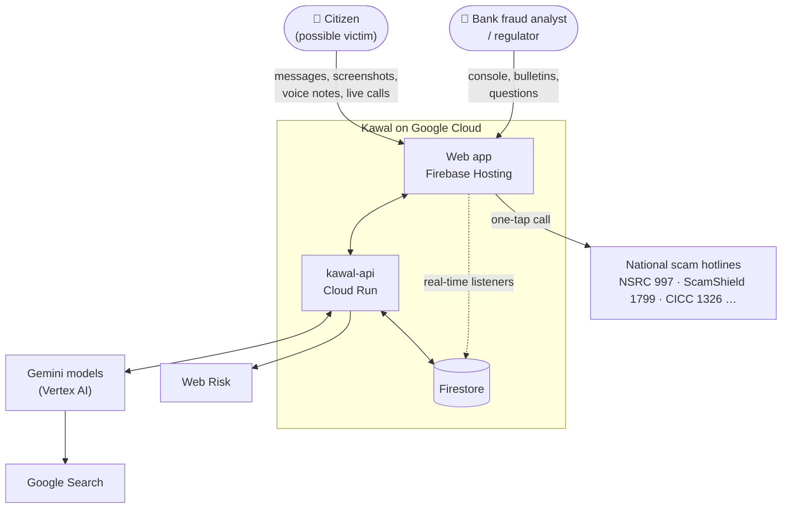
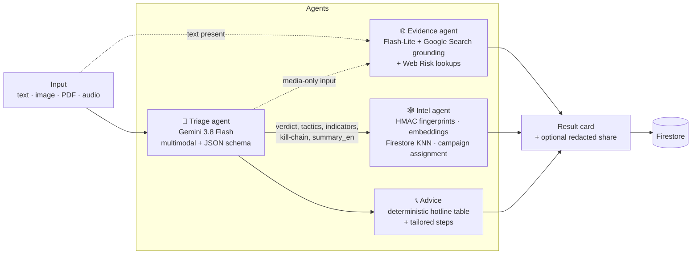
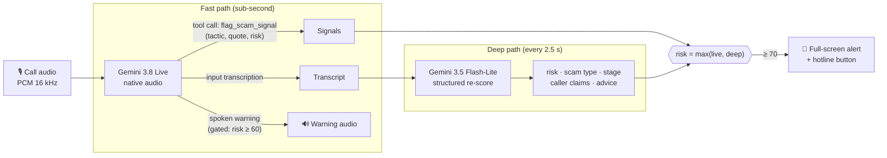
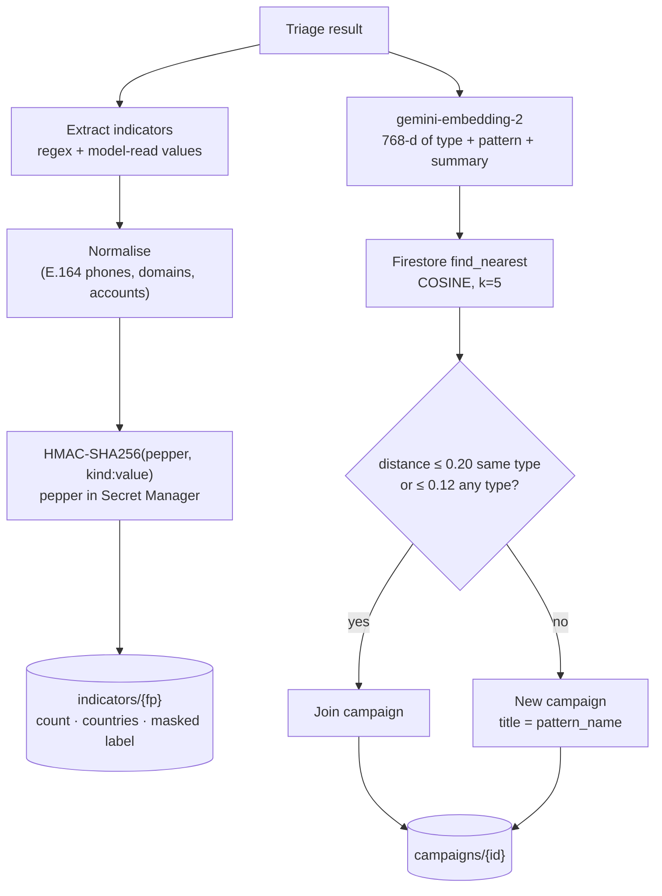
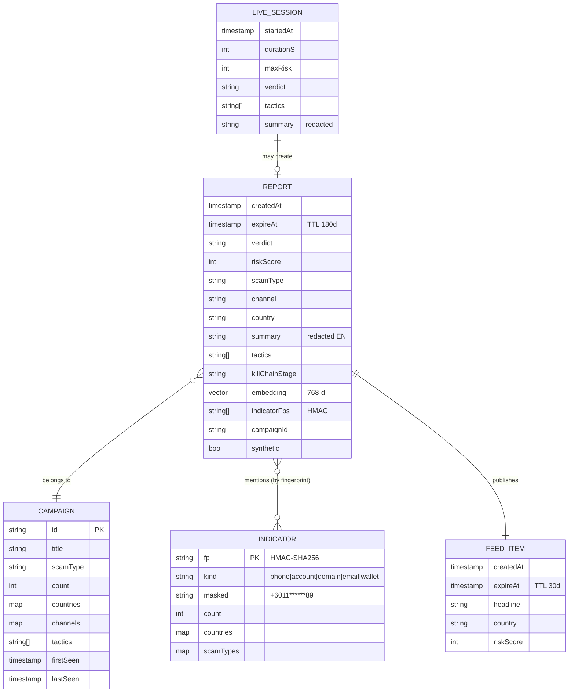
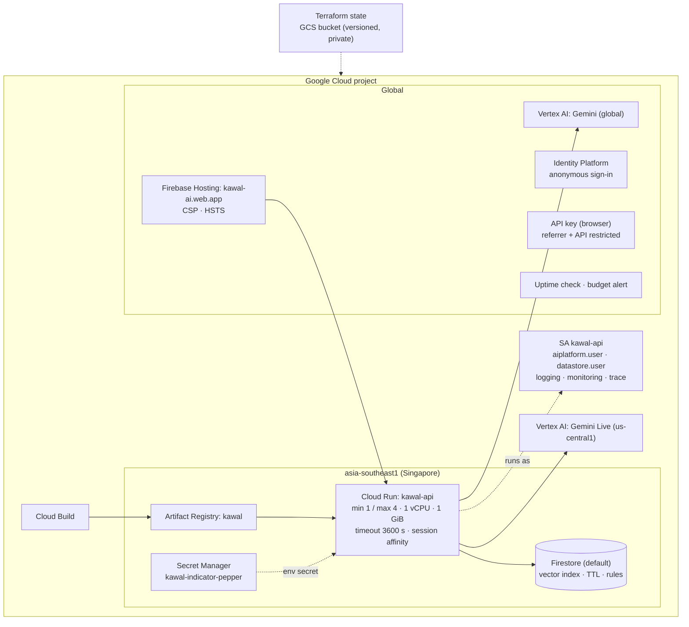

# Kawal - Architecture

This document explains how Kawal is put together and why. For the one-page overview see the
[README](../README.md).

- [1. Design goals](#1-design-goals)
- [2. System context](#2-system-context)
- [3. Scam Check: the agent pipeline](#3-scam-check-the-agent-pipeline)
- [4. Live Call Guardian: fast path + deep path](#4-live-call-guardian-fast-path--deep-path)
- [5. Community intelligence: fingerprints, vectors, campaigns](#5-community-intelligence-fingerprints-vectors-campaigns)
- [6. Intel Console agents](#6-intel-console-agents)
- [7. Data model](#7-data-model)
- [8. Deployment topology (Terraform)](#8-deployment-topology-terraform)
- [9. Security model](#9-security-model)
- [10. Model choices](#10-model-choices)
- [11. Scaling beyond the prototype](#11-scaling-beyond-the-prototype)

---

## 1. Design goals

| Goal | Consequence in the design |
|---|---|
| **Intervene while the victim is being persuaded** | A streaming, sub-second detection path (Gemini Live + function calling) - not a batch classifier. |
| **Explain, don't just score** | Every verdict carries quoted evidence, a tactic taxonomy, a kill-chain stage and grounded sources. |
| **Speak the user's language** | Detection is language-agnostic; output follows the user's language (EN / BM / 中文 UI, more via Gemini). |
| **Every check protects the next person** | Redacted reports are embedded and clustered into campaigns; indicators are counted via fingerprints. |
| **Privacy by default** | No raw content is stored; indicators are HMAC'd; TTLs; browsers are read-only. |
| **Deployable by anyone** | 100% Terraform; one script deploys API + infra + web. |

## 2. System context

## 3. Scam Check: the agent pipeline

`POST /api/check` accepts text plus up to three files (images, PDFs, audio) and streams **Server-Sent Events**
so the UI shows each agent finishing. The **Evidence** agent starts *in parallel with* **Triage** whenever text
is present, so grounding costs no extra wall-clock time.

**Triage output (excerpt of the JSON schema):** `verdict` · `risk_score` · `scam_type` (14 types) ·
`red_flags[] {tactic, evidence quote, why}` (12 tactics) · `kill_chain_stage` (contact → hook → pressure →
extraction → cash-out) · `indicators[]` · `do_now[]` · `dont[]` · `pattern_name` · `summary_en` (redacted).

**Guard-rails**

- The prompt treats submitted content as *untrusted* - instructions inside a message are themselves a red flag.
- Enum outputs are clamped server-side to the taxonomy; hotline numbers come from a static, verified table,
  never from the model.
- Web Risk is authoritative: a flagged URL forces `verdict = scam`.
- A 429/503 from the primary model triggers SDK retries with back-off, then an automatic fallback model.

## 4. Live Call Guardian: fast path + deep path

The browser captures audio with an `AudioWorklet` (16 kHz, 16-bit PCM, 100 ms frames) - from the microphone, or
from a sample call that is played *and* streamed at real-time pace. Cloud Run bridges the WebSocket to a
Gemini Live session and runs a second, slower scorer on the transcript.

**Why two paths?** The Live model hears tone, urgency and code-switching directly and reacts within a turn, but a
single model call is noisy as a *score*. Flash-Lite re-reads the whole transcript every 2.5 s and produces a
calibrated, explainable risk, scam type and kill-chain stage. The meter shows the max of the two; the deep path
only adds tactic chips once the call is genuinely suspicious (risk ≥ 50), which keeps legitimate calls clean.

**Live session settings**

| Setting | Value | Why |
|---|---|---|
| `response_modalities` | `AUDIO` | Native-audio model; we also enable output transcription. |
| `proactivity.proactive_audio` | `true` | Lets the model stay silent - essential for a listener. |
| `activity_handling` | `NO_INTERRUPTION` | Scammers talk over warnings; Kawal must finish its sentence. |
| VAD | high start/end sensitivity, 450 ms silence | Turn boundaries match natural call pauses. |
| Voice gate | risk ≥ 60 | Server drops any model audio before the call is clearly risky. |
| Control-token filter | strips `<no speech>`, `{pause}` | Native-audio artefacts never reach the UI. |

At the end of a call, Flash-Lite writes a summary; only the **redacted** outcome (verdict, type, tactics,
peak risk, duration) is stored - never audio or the transcript.

## 5. Community intelligence: fingerprints, vectors, campaigns

All side-effects of a report (report doc, indicator counters, campaign counters, global stats, feed item) are
written in **one Firestore batch** so the console never shows half-written state.

## 6. Intel Console agents

- **Real-time:** the console subscribes to `feed` and `stats/global` with Firestore `onSnapshot`, so a check
  made anywhere appears within a second.
- **Bulletin agent** (`POST /api/intel/bulletin`): aggregates the last 14 days (campaign week-over-week counts,
  countries, channels, tactics) and asks Gemini 3.8 Flash (thinking: medium) for a schema-bound bulletin: threat
  level, campaign narratives, **bank controls**, **mule-account signals** and SMS advisories in EN/BM/中文.
- **Analyst agent** (`POST /api/intel/ask`): Gemini 3.8 Flash with five tools - `get_overview`,
  `list_campaigns`, `search_reports` (semantic), `daily_counts`, `lookup_indicator` (fingerprinted). Up to five
  tool rounds; the full tool trace is returned and shown so answers are auditable.

## 7. Data model

`stats/global` holds running counters (reports, verdicts, by type / country / channel, live sessions,
estimated loss averted) and `bulletins/*` the generated bulletins.

## 8. Deployment topology (Terraform)

`scripts/deploy.sh` builds the image on Cloud Build, applies Terraform with the new image tag, generates the web
env from Terraform outputs and deploys Hosting. Details: [DEPLOYMENT.md](DEPLOYMENT.md).

## 9. Security model

| Threat | Mitigation |
|---|---|
| Anyone calling the API / burning Gemini quota | Firebase ID token required on every call and WebSocket; per-uid rate limits; Cloud Run max instances; budget alert. |
| Cross-site WebSocket hijacking | `Origin` must match the hosting domains; token sent in the first frame (never in the URL). |
| Leaking victims' data | Raw content never stored; HMAC fingerprints; redacted summaries; TTL; Firestore rules deny all client writes and all reads of reports/indicators/sessions. |
| Leaked credentials in a public repo | No service-account keys or API keys in code; Cloud Run uses its identity; browser key is restricted; `.gitignore` covers env/tfvars/state/keys. |
| Prompt injection inside a scam message | Content is wrapped and declared untrusted; instruction-like text is a red flag; outputs are schema-bound and clamped. |
| Malicious uploads | MIME allow-list, 8 MB cap, at most 3 files; content goes only to Gemini, never to disk. |
| XSS / clickjacking | React escaping, strict CSP (`script-src 'self'`), `frame-ancestors 'none'`, `nosniff`, HSTS. |
| Model hallucinating a hotline | Hotlines come from a static, reviewed table keyed by country. |

## 10. Model choices

| Task | Model | Reason |
|---|---|---|
| Triage (multimodal, structured) | `gemini-3.8-flash` (thinking: low) | Best reasoning on mixed-language, image and audio inputs; JSON schema. |
| Grounded evidence | `gemini-3.5-flash-lite` + Google Search | ~3 s, so it finishes inside the triage window. |
| Live listening | `gemini-3.8-live` | Native audio, function calling, proactive audio, multilingual switching. |
| Live re-scoring / call summary | `gemini-3.5-flash-lite` (thinking: minimal/low) | Runs every 2.5 s - needs to be fast and cheap. |
| Embeddings | `gemini-embedding-2` @ 768-d | Multilingual; fits Firestore's vector limits. |
| Read-aloud, sample calls | `gemini-3.8-flash-tts` | Natural BM / EN / 中文 voices. |
| Fallback on 429/503 | `gemini-3.5-flash` | Keeps the demo responsive under shared-capacity spikes. |

## 11. Scaling beyond the prototype

- **Throughput:** Cloud Run scales horizontally; Gemini calls are stateless. Move rate limiting to Firestore /
  Memorystore when running more than a handful of instances; add Provisioned Throughput for predictable latency.
- **Intel store:** Firestore handles the write pattern (one batch per report). For analytics at bank scale, stream
  reports to BigQuery and keep Firestore for the live console.
- **Integrations:** expose a signed webhook so a bank can receive "customer is on a live scam call" events and
  trigger step-up authentication or a cooling-off period on outgoing transfers.
- **On-device:** a Gemma model on Android for a private first-pass, escalating to Gemini only when risky.
