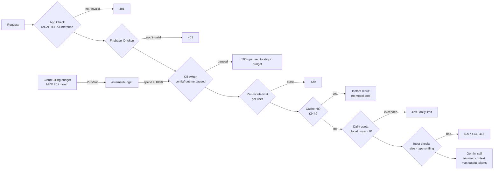

# Cost & abuse controls

Kawal is open source and its API is public, so anyone can read the code and try to call it. The deployment is
built so that **the monthly bill stays near zero and can never run away**, no matter who calls it.

## 1. Layers

| # | Layer | Where | What it stops |
|---|---|---|---|
| 1 | **Firebase App Check** (reCAPTCHA Enterprise, invisible) | API (`X-Firebase-AppCheck`, WebSocket first frame), Firestore and Firebase Auth enforcement | Scripts, bots and copies of the open-source frontend calling *our* backend; mass anonymous-account creation |
| 2 | **Firebase Auth** ID token | every API call and WebSocket | Unauthenticated calls; gives each browser a uid for quotas |
| 3 | **Kill switch** `config/runtime.paused` | `guard.ensure_open()` on every AI endpoint | All model spend, instantly (cached 30 s per instance) |
| 4 | **Budget circuit breaker** | Billing budget → Pub/Sub → `POST /internal/budget` (OIDC-verified) | Spend beyond the monthly budget; auto-resumes next month |
| 5 | **Per-minute limits** | `auth.RateLimiter` | Bursts (e.g. 12 checks / min / user) |
| 6 | **Daily quotas** - global, per user, per IP (hashed) | Firestore counters in a transaction (`guard.consume`) | The real ceiling: bounded worst-case daily spend |
| 7 | **Caching** | Firestore `cache/` (24 h), bulletin reuse (60 min), TTS LRU, overview snapshot (30 s) | Paying twice for the same answer - judges click the same examples |
| 8 | **Context trimming** | request validation + model configs | Huge inputs / outputs: 4 000-char text, ≤ 2 files, image 4 MB / audio 3 MB / PDF 2 MB, magic-byte sniffing, `max_output_tokens` on every call, live sessions ≤ 150 s, scorer window 3 000 chars and ≤ 40 re-scores, analyst ≤ 4 tool rounds with results capped at 3 000 chars |
| 9 | **Topic & injection guards** | prompts | Using the analyst as a free chatbot ("I can only answer questions about Kawal's scam intelligence"); instructions hidden in scam messages |
| 10 | **Infra sizing** | Terraform | Cloud Run scales to **zero**, max 2 instances, 512 MiB; uptime check every 15 min; image retention 3 |

## 2. Default ceilings

Set in `infra/variables.tf` (`global_daily`, `user_daily`, `ip_daily`), passed to Cloud Run as JSON. A partial
override never removes the other caps.

| Feature | Global / day | Per user / day | Per IP / day |
|---|---|---|---|
| Scam Check (uncached) | 150 | 20 | 40 |
| Web grounding (Google Search) | 60 - then checks continue without it | - | - |
| Live Call Guardian session (≤ 150 s each) | 25 | 5 | 10 |
| Read-aloud (TTS) | 40 | 10 | 20 |
| Ask Kawal Intel | 60 | 15 | 30 |
| New threat bulletin | 8 | 3 | 5 |

Live usage is public at `GET /api/usage`.

## 3. What it costs

*Estimates from public list prices at the time of writing - verify with the Google Cloud pricing calculator.*

| Item | Monthly |
|---|---|
| Cloud Run (scale to zero, request-based billing) | ≈ 0 - inside the free tier at demo traffic |
| Firestore, Hosting, Auth, Pub/Sub, Secret Manager, Cloud Build, Monitoring | ≈ 0 - free tiers |
| reCAPTCHA Enterprise (App Check), Web Risk | ≈ 0 - free tiers |
| Artifact Registry (3 images) | < USD 0.05 |
| Gemini at realistic judging traffic (tens of checks / calls per day) | ≈ MYR 1-5 |
| **Typical total** | **≈ MYR 0-5 / month** |

**Worst case** (someone exhausts every global cap every day): roughly USD 2.5-4 / day of model spend. The
**MYR 20 budget breaker** then pauses AI features; because Cloud Billing data can lag by up to a day, the
realistic hard ceiling is about **budget + one day of maximum usage ≈ MYR 35 / month**.

## 4. Alerts (e-mail to `var.alert_email` + billing admins)

| Alert | Trigger |
|---|---|
| Budget thresholds | 25 / 50 / 75 / 90 / 100 % of actual spend, 100 % forecast |
| **Budget breaker engaged** | log-based metric `kawal_breaker_trips` > 0 |
| **Abuse spike** | more than 30 quota rejections in an hour (`kawal_quota_rejections`) |
| API down | uptime check failing for 15 min |

## 5. Operating it

| Task | How |
|---|---|
| Pause everything now | Firestore → `config/runtime` → set `paused: true` (or `reason`), effective within 30 s |
| Resume | set `paused: false` - or wait for the next budget period if the breaker paused it |
| Raise / lower ceilings | edit `global_daily` / `user_daily` / `ip_daily` in `terraform.tfvars`, `scripts/deploy.sh api` |
| Change the budget | `budget_amount` in `terraform.tfvars` (billing-account currency), `terraform apply` |
| Keep an instance warm for a live demo | `min_instances = 1` (≈ USD 10-15 / month), set back to 0 afterwards |
| Turn App Check off (e.g. local dev) | `appcheck_enforce = false`, or leave `VITE_RECAPTCHA_SITE_KEY` empty locally |
| Headless tests / demo recording | register a UUID as `appcheck_debug_token` in `terraform.tfvars` and set `self.FIREBASE_APPCHECK_DEBUG_TOKEN` in the test browser - never commit it |

## 6. Verified in production (16 Oct 2026)

| Test | Result |
|---|---|
| API call without App Check token | `401 Missing App Check token` |
| Scripted anonymous sign-up without App Check | rejected by Firebase Auth |
| Executable renamed to `.png` | `415 File content does not match its type` |
| Prompt injection against the analyst | refused, no tool calls |
| 14-request burst | `429` after the per-minute limit |
| Repeat of an identical check | served from cache in ~0.1 s, not counted against quotas |
| Simulated over-budget notification (MYR 25 / 20) | kill switch engaged, AI endpoints return `503` |
| Simulated new budget period | kill switch released automatically, checks work again |
