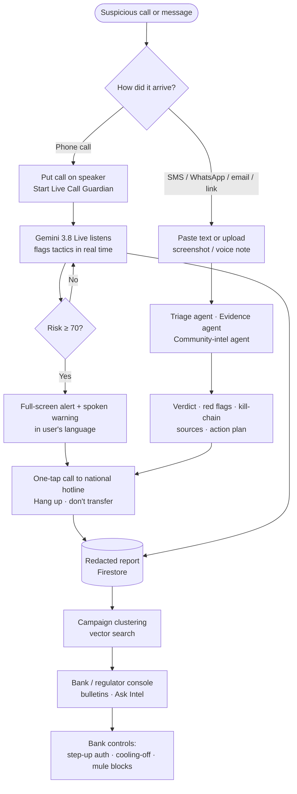

# Pitch deck content - Kawal (Team AwanPurple)

Slide-by-slide content for the official **AI Builder Cup submission template** (16 slides). Copy each block
into the matching slide. Diagram and screenshot images are in [`docs/images/`](images/) - every diagram also
renders live on GitHub from the Mermaid source in [ARCHITECTURE.md](ARCHITECTURE.md).

> Tip: keep each slide to the **bold lines** if space is tight; the sub-bullets are speaker notes.

---

## Slide 1 - Team details

- **a. Team name:** AwanPurple
- **b. Team leader name:** Darwish Irfan Bin Zulhailmy
  - Members: Muhammad Awzai Ammar Bin Anuar · Nur Amni Syazwani Binti Mohamad Nasir
- **c. Problem statement:** **BFSI - Intelligent Risk, Fraud & Financial Experiences.**
  Scams are now the largest consumer financial-crime loss in Asia-Pacific, and the most damaging ones succeed
  *while the victim is on the phone* - persuaded in real time to move their own money. Banks and existing
  anti-scam tools act on known numbers, links and transactions *after* the fact; nothing protects people at
  the moment of persuasion, in their own language, and nothing turns each near-miss into intelligence that
  stops the next victim.

## Slide 2 - (template note slide - leave as is / delete before export)

## Slide 3 - Brief about the idea

**Kawal - the AI that sits on the call with you.**
*Kawal* means “guard” in Malay and Indonesian.

- **The gap:** Southeast Asians lost **US$23.6 bn** to scams in 12 months; **63%** experienced one (GASA 2025).
  Malaysia: **67,735** cases and **> RM2.7 bn** lost Jan-Nov 2025, with **telecom (phone) scams the #1 category
  (28,698 cases)** (PDRM via Bernama). Singapore: **81.8%** of losses are *self-effected transfers* - the victim
  presses “send” while being manipulated (SPF 2025).
- **What Kawal does:**
  1. **Live Call Guardian** - put a suspicious call on speaker; **Gemini 3.8 Live** hears it in real time, flags
     scam tactics (fake police, “safe account”, secrecy, OTP requests) within about a second, shows a live risk meter
     and **speaks a warning in the victim's language**.
  2. **Scam Check** - paste a message or drop a screenshot / voice note; a **multi-agent Gemini pipeline** returns an
     explainable verdict, grounded evidence, the scam's stage and the right national hotline.
  3. **Intel Console** - every check becomes **redacted, real-time intelligence**: Firestore vector search clusters
     reports into campaigns; Gemini writes threat bulletins with bank controls; analysts can query it in plain language.
- **Built on Google Cloud:** Gemini (3.8 Flash, 3.8 Live, Flash-Lite, embeddings, TTS) · Cloud Run · Firestore ·
  Firebase Hosting/Auth/Rules · Web Risk · Terraform.

## Slide 4 - Opportunities

**How is it different from existing ideas?**
- Existing tools (bank blocklists, ScamShield / Semak Mule-style lookups, SMS filters) are **reactive and
  indicator-based** - they need a known bad number or link. Kawal is **behaviour-based and real-time**: it
  recognises *manipulation tactics* in a live conversation even from a brand-new number.
- Most AI scam checkers stop at a text classifier. Kawal is **multimodal** (calls, voice notes, screenshots, PDFs,
  text), **multilingual with code-switching** (EN/BM/中文 and more) and **explainable** (quoted evidence,
  kill-chain stage, grounded sources).
- It closes the loop **from citizen to bank**: each check feeds privacy-preserving intel (HMAC fingerprints +
  embeddings) that banks and regulators can act on the same day.

**How will it solve the problem?**
- **Interrupts the persuasion** at the exact moment money is about to move (risk meter → full-screen alert → spoken
  warning → one-tap call to NSRC 997 / ScamShield 1799 / CICC 1326 …).
- **Removes the “is this real?” doubt** with a calm, plain-language explanation and grounded evidence from
  official sources.
- **Shrinks the time-to-detection for banks**: campaigns surface from citizen reports before transaction data shows
  losses; bulletins propose concrete controls (e.g. step-up authentication when a customer is on an active call,
  cooling-off for first-time payees, mule-account velocity rules).

**USP**
- **Real-time, in-call, in-language intervention** using Gemini Live with function calling - silent by default,
  speaks only when risk is high.
- **Dual-path detection:** sub-second Live tactic flags + Flash-Lite calibrated re-scoring = fast *and* low false alarms
  (0 alerts on the legitimate-bank control call).
- **Privacy-first network effect:** no raw messages or audio stored; indicators are HMAC fingerprints; reports TTL-expire.
- **Production-shaped from day one:** 100% Terraform, least-privilege identity, no API keys in the backend.

## Slide 5 - List of features

**For citizens (B2C / bank-app embed)**
1. 📞 **Live Call Guardian** - real-time transcription, tactic detection (12 tactics), risk meter, kill-chain
   tracker, full-screen alert, spoken warning in the user's language, call summary.
2. 🔍 **Multimodal Scam Check** - text, links, screenshots, PDFs, voice notes → verdict, 0-100 risk, quoted red flags,
   kill-chain stage, “what to do now / don't”.
3. 🌐 **Grounded verification** - Google Search-grounded findings with sources + Google **Web Risk** link reputation.
4. 🧭 **Country-aware action plan** - verified hotlines for 12 JAPAC markets with one-tap calling.
5. 🗣️ **Accessibility** - EN / BM / 中文 UI, read-aloud (Gemini TTS), large-text mode, mobile-first.
6. 🛡️ **Share anonymously** - opt-in, redacted pattern sharing that protects the next person.

**For banks, regulators, telcos (B2B)**
7. 📊 **Intel Console** - live KPIs, 21-day trend, campaign clusters with sparklines and week-over-week trend,
   top manipulation tactics, repeat indicators (masked), real-time feed.
8. 📰 **Gemini threat bulletins** - threat level, campaign narratives, recommended bank controls, mule-account
   signals, SMS advisories in EN / BM / 中文.
9. 🤖 **Ask Kawal Intel** - analyst agent with tool calling over Firestore (semantic search, indicator lookup,
   trends) and an auditable tool trace.

**Platform**
10. 🔐 Firebase Auth on every call, per-user rate limits, Web Risk override, prompt-injection guard, strict CSP.
11. ⚙️ One-command deployment with Terraform + Cloud Build.

## Slide 6 - Process flow / use-case diagram

Image: `docs/images/process-flow.png` (source below).

Use-case summary: **Citizen** - check message, guard live call, get action plan, share anonymously.
**Fraud analyst** - monitor campaigns, generate bulletin, query intel, look up an indicator.
**Regulator** - track national trends, publish multilingual advisories.

## Slide 7 - Wireframes / mock diagrams (optional)

Use the real UI instead of wireframes - screenshots in `docs/images/`:
`ui-check.png` (input + example chips), `ui-result.png` (verdict card), `ui-live.png` (risk meter + transcript),
`ui-alert.png` (full-screen alert), `ui-intel.png` (console).

## Slide 8 - Architecture diagram

Image: `docs/images/architecture.png` (also rendered in the README).

Talking points:
- **Firebase Hosting** serves the React app; **Firebase Auth** issues anonymous ID tokens; **Security Rules** keep
  browsers read-only.
- **Cloud Run** (Singapore) hosts FastAPI: **SSE** for the agent pipeline, **WebSocket** bridge to **Gemini Live**.
- **Gemini 3.8 Flash** (triage, bulletins, analyst agent), **3.8 Live** (call listening), **3.5 Flash-Lite**
  (grounding, live re-scoring), **embeddings** (campaigns), **TTS** (read-aloud, sample calls).
- **Firestore**: redacted reports + **KNN vector index**, HMAC indicators, campaigns, stats, feed; TTL policies.
- Secret Manager (HMAC pepper), Web Risk, Artifact Registry, Cloud Build, Monitoring, all via **Terraform**.

## Slide 9 - Technologies used

| Layer | Technology |
|---|---|
| **Generative AI** | Gemini 3.8 Flash (multimodal, structured output, function calling) · Gemini 3.8 Live (native audio, proactive audio, tools) · Gemini 3.5 Flash-Lite · gemini-embedding-2 · Gemini 3.8 Flash TTS · Google Search grounding |
| **Compute** | Cloud Run (FastAPI, Python 3.13, uvicorn, WebSockets, SSE) · Cloud Build · Artifact Registry |
| **Data** | Firestore (Native) - vector search (KNN, cosine, 768-d), TTL, real-time listeners |
| **Firebase** | Hosting · Authentication (Identity Platform, anonymous) · Security Rules · JS SDK |
| **Security** | Web Risk API · Secret Manager · least-privilege IAM · restricted API keys · CSP/HSTS |
| **Frontend** | React 19 · TypeScript · Vite · Tailwind CSS 4 · Web Audio AudioWorklet |
| **IaC & ops** | Terraform (google / google-beta 8.x) · Cloud Monitoring uptime check · billing budget alert · pytest · ruff |

## Slide 10 - Estimated implementation cost

*Estimates from public list prices at the time of writing; verify with the Google Cloud pricing calculator.
Gemini costs scale with tokens - figures below assume our measured prompt sizes.*

**Prototype (current deployment) - engineered for near-zero cost**

| Item | Monthly |
|---|---|
| Cloud Run (scale to zero), Firestore, Hosting, Auth, Pub/Sub, Secret Manager, reCAPTCHA, Web Risk | ≈ MYR 0 (free tiers) |
| Gemini at judging traffic (tens of checks / calls a day) | ≈ MYR 1-5 |
| **Typical total** | **≈ MYR 0-5 / month** |
| **Hard ceiling** | daily per-feature quotas + MYR 20 budget circuit breaker (auto-pause) ≈ MYR 35 worst case |

**Unit economics (production)**

| Action | Approx. Gemini cost |
|---|---|
| One Scam Check (triage + grounded evidence + embedding) | ≈ USD 0.01-0.03 |
| One minute of Live Call Guardian (Live audio + re-scoring) | ≈ USD 0.01-0.02 |

**National-scale scenario (e.g. one Malaysian bank's app, 1 M checks + 200 k guarded call-minutes / month)**
≈ USD 15-35 k / month all-in - about **USD 0.02 per protected interaction**. Malaysia lost **> RM2.7 bn (≈ USD 600 M)**
to scams in 11 months of 2025; preventing **0.1%** of that pays for the platform several times over.

## Slide 11 - Snapshots of the prototype

Insert from `docs/images/`:
1. `ui-check.png` - Scam Check input with multilingual examples.
2. `ui-result.png` - “SCAM 100” verdict: quoted red flags, kill-chain, NSRC 997 button, grounded sources,
   “part of campaign · reported 3× before”.
3. `ui-live.png` - Live Call Guardian: risk meter, caller claims, tactic chips, live transcript (Bahasa Melayu).
4. `ui-alert.png` - full-screen “STOP - this is a scam pattern” alert with one-tap hotline.
5. `ui-intel.png` - Intel Console: KPIs, trend, campaigns, live feed.
6. `ui-bulletin.png` - Gemini threat bulletin with bank controls and EN/BM/中文 advisories.

## Slide 12 - Prototype performance report / benchmarking

Full method and raw data: [BENCHMARK.md](BENCHMARK.md).

**Scam Check - accuracy (held-out, hand-labelled, multilingual; n = 30: 20 scams, 10 tricky legitimate)**

| Metric | Result |
|---|---|
| Accuracy | **100%** (30/30) |
| Precision / Recall | **1.00 / 1.00** |
| False-positive rate | **0%** - real bank OTP & debit alerts, courier delivery notices, family texts all passed |
| Languages | English, Bahasa Melayu, 中文, Bahasa Indonesia |
| Triage latency | p50 **5.3 s**, p95 **6.7 s** |

**Scam Check - production latency (Cloud Run → Gemini)**: **4.1-6.9 s end-to-end** with the Evidence (≈2 s) and
Intel (≈0.4 s) agents fully overlapped with triage; results stream stage-by-stage.

**Live Call Guardian (production, real-time paced sample calls)**

| Call | Result |
|---|---|
| 🇲🇾 Macau scam (BM) | First tactic flagged **0.2 s** after the caller's first sentence; alert as soon as the accusation lands; caught threat → secrecy → *safe account*; peak risk **98**; spoken BM warning |
| 🇸🇬 Fake bank fraud team (EN) | See BENCHMARK.md |
| 🇨🇳 Parcel + fake police (中文) | First alert at **≈ 12 s**; spoken Mandarin warning; peak risk **95** |
| ✅ Genuine bank call (control) | **0 alerts, 0 spoken output**, verdict *likely safe* |

Caveat: small, team-labelled set - a larger, independently labelled evaluation is on the roadmap.

## Slide 13 - Additional details / future development

- **Pilot path:** (1) embed Kawal's Scam Check + Live Guardian SDK in a bank app; (2) bank receives a signed
  “customer is on a live scam call” event and applies **step-up auth or a cooling-off period** on outgoing
  transfers; (3) share campaign intel with NSRC / regulators.
- **On-device Gemma** first pass for privacy and offline use; escalate to Gemini only when risky.
- **Android companion** that guards calls with consent (no speakerphone needed) and screens shared screenshots.
- **More languages & dialects:** Tamil, Tagalog, Thai, Vietnamese, Cantonese, Hokkien.
- **Federated intel** across banks using the same HMAC scheme - mule accounts surface across institutions without
  sharing PII. Stream to BigQuery for analytics at scale.
- **Responsible AI:** larger independent evaluation set, red-teaming against adversarial scripts and deepfake voices,
  human-in-the-loop review for published bulletins.

## Slide 14 - Links

- **GitHub public repository:** https://github.com/wishwhitehat/kawal
- **Demo video (3 minutes):** https://drive.google.com/file/d/1wYByug6AXhn4cdVww69Z02nbbA-v2ERV/view?usp=drive_link
- **Final product link:** https://kawal-ai.web.app

## Slide 15 - (spare) - suggested: “Why now / Why Google Cloud”

- Gemini Live's native audio + tool calling makes in-call, multilingual intervention possible for the first time.
- Cloud Run + Firestore + Firebase let a 3-person team ship a secure, scalable product in days.
- Data stays in-region (asia-southeast1) - a requirement for BFSI partners in ASEAN.

## Slide 16 - Thank you
